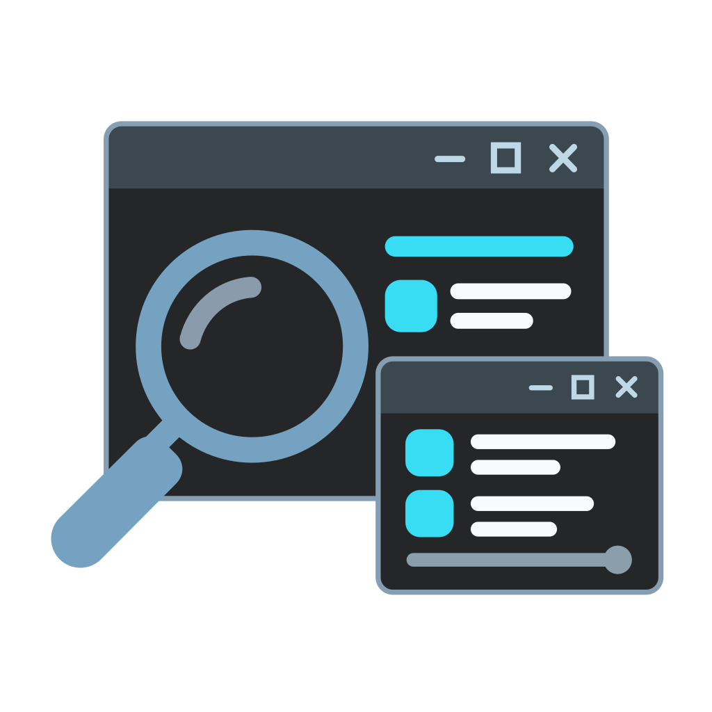
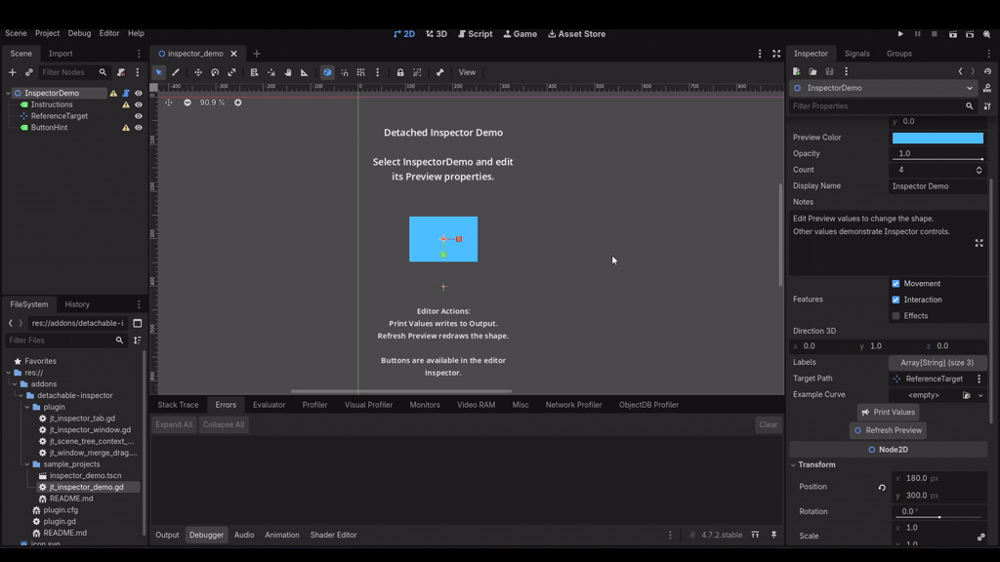
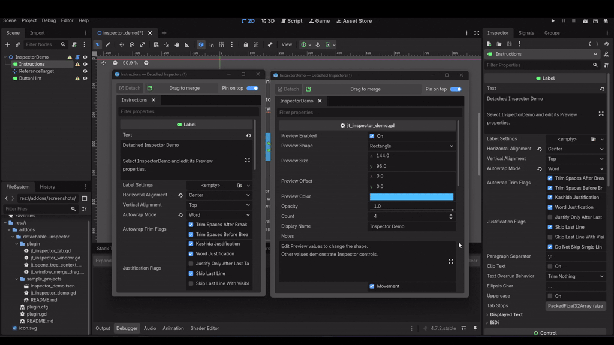

<h1 align="center">Godot Detached Inspector Plugin</h1>

  

    
     
    
    
    
By <strong>JoenTNT</strong>

---

> Keep a scene node's Inspector open in a **separate native window** while selecting other nodes in Godot.

  <table>
    <tr>
      <td align="center" width="50%">
         
        <b>Preview</b>
      </td>
      <td align="center" width="50%">
         
        <b>Window Merge</b>
      </td>
    </tr>
  </table>

## How to Install?

1. Copy the complete `addons/detachable-inspector/` folder into your project's
   `addons/` directory, keeping that folder name and its UID files.
2. Open **Project → Project Settings → Plugins** and enable **Detached Inspector**.
3. Open a scene and select exactly one node in the local Scene tree.

> NOTE: When updating, close detached windows and disable the plugin before replacing
files, then re-enable it.

---

## QUICK DOCUMENTATION

> Documentation updated **17 October 2026** for version **0.1.0**.
> Requires Godot **4.7+**; native UI and platform verification remain manual.

### A. Quick Usage

- Right-click a node → **Open in Detached Inspector** 
- Select a node and use
**Project → Tools → Open Detached Inspector**.

  

---

### B. WINDOWS AND TABS

The toolbar is **Detach | Drag to merge | Pin on top**.

| Control | Behavior |
| --- | --- |
| **Detach** | Move the active tab into a new window. |
| **Drag to merge** | Drag this expanding toolbar button onto another inspector's merge button. Release when it reads **Release to merge here**. |
| **Pin on top** | Keep the window above the main editor and other applications without blocking their input. |

## PATCH LOGS

### Version 0.1.0

- Initial Commit Version.